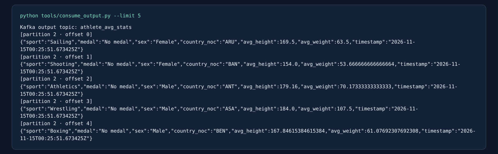
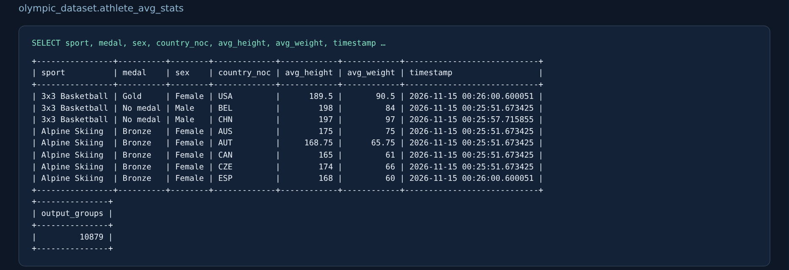
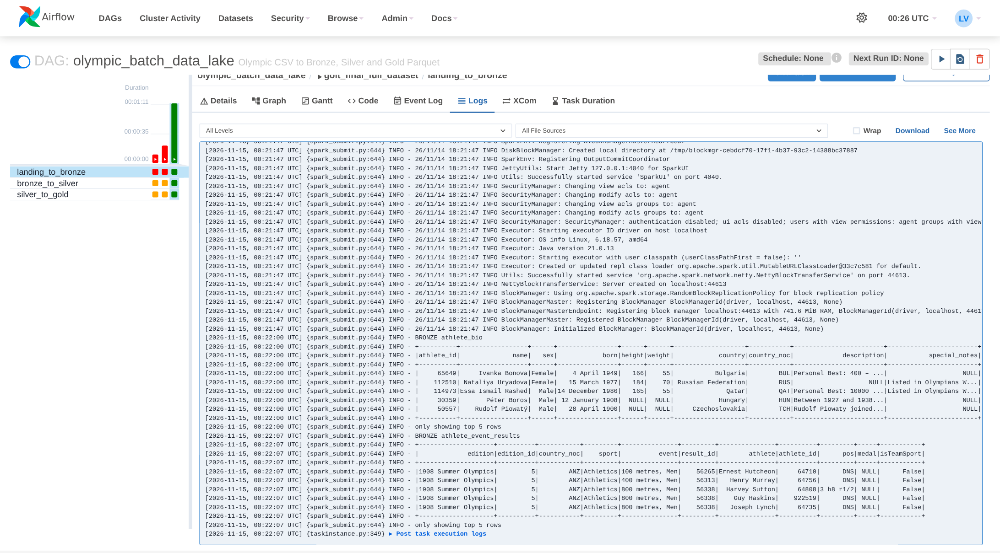
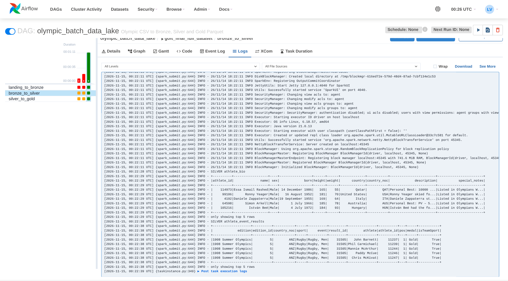
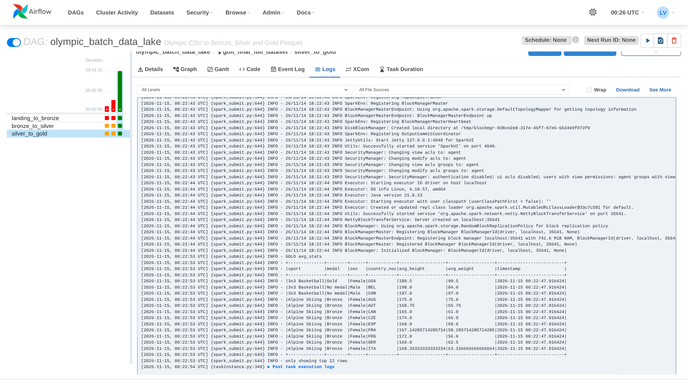
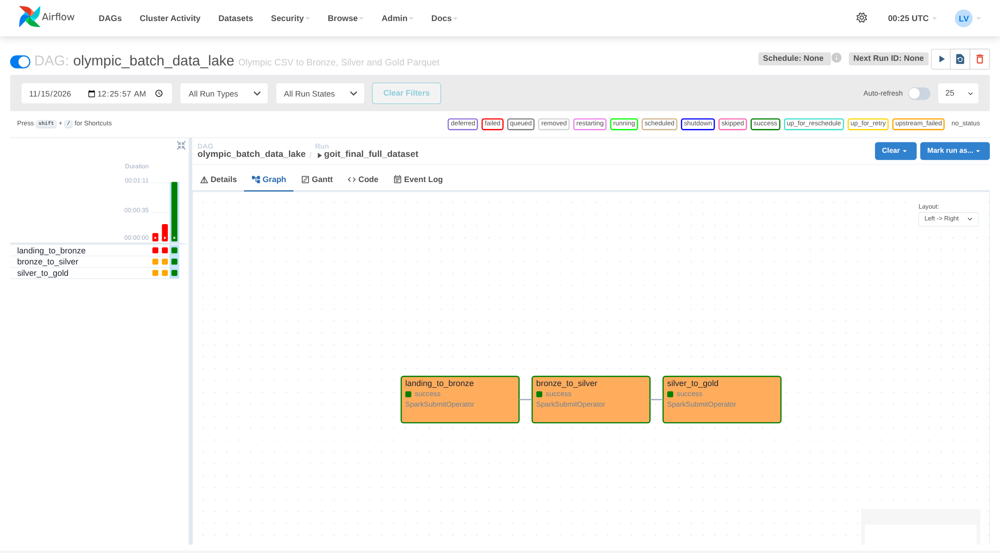

# Olympic Pipeline Verification

The full GoIT CSV snapshots were used in both runs. The batch pipeline downloaded them directly from GoIT. For the streaming test, the same CSVs were loaded into a local MySQL 8.4.5 server because course MySQL credentials were not provided. Apache Kafka 4.1.2, Spark 4.0.1 and Airflow 2.11.2 were used. All evidence is from these local runs, not from the GoIT-hosted cluster.

## Part 1 — Streaming pipeline

| Measurement | Verified result |
|---|---:|
| Source athlete bios imported into MySQL | 155,861 |
| Source event results imported into MySQL and published to Kafka | 316,834 |
| Spark data microbatches | 3 |
| Output messages across the three microbatches | 10,969 |
| Latest groups in Kafka | 10,879 |
| Latest groups in MySQL | 10,879 |

The latest Kafka value for every group matched its MySQL row, including both numerical averages and the UTC calculation timestamp. See the [verification output](evidence/stream-output-verification.txt), the [Kafka consumer output](evidence/kafka-output.txt) and the [MySQL query output](evidence/mysql-output.txt).

## Part 2 — Batch data lake

Airflow run `goit_final_full_dataset` completed successfully. All three tasks used `SparkSubmitOperator` via the configured `spark-default` connection.

| Layer | Table | Verified rows |
|---|---|---:|
| Bronze | `athlete_bio` | 155,861 |
| Bronze | `athlete_event_results` | 316,834 |
| Silver | `athlete_bio` | 155,861 |
| Silver | `athlete_event_results` | 315,626 |
| Gold | `avg_stats` | 10,879 |

The task screenshots include the Airflow log timestamp on the left and the Spark `show()` output. The final screenshot shows the Airflow Graph for the completed run.

