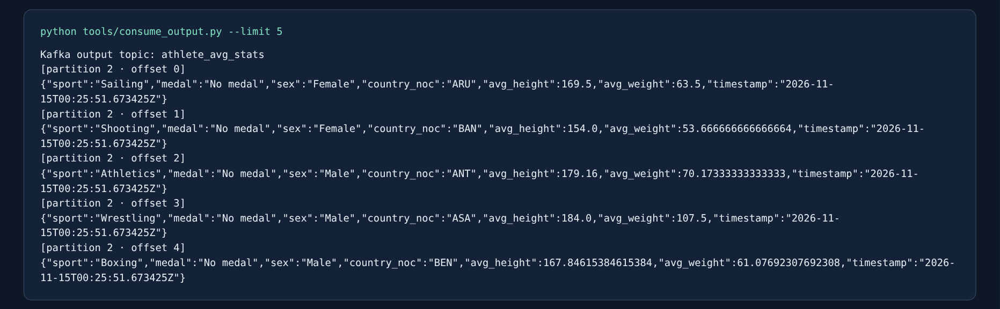
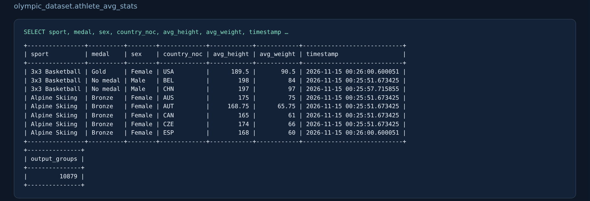
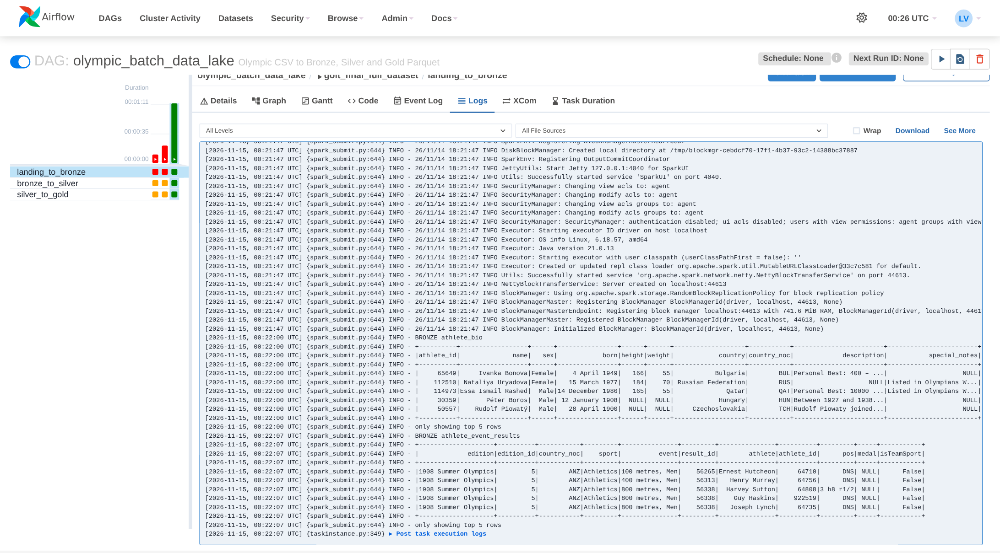
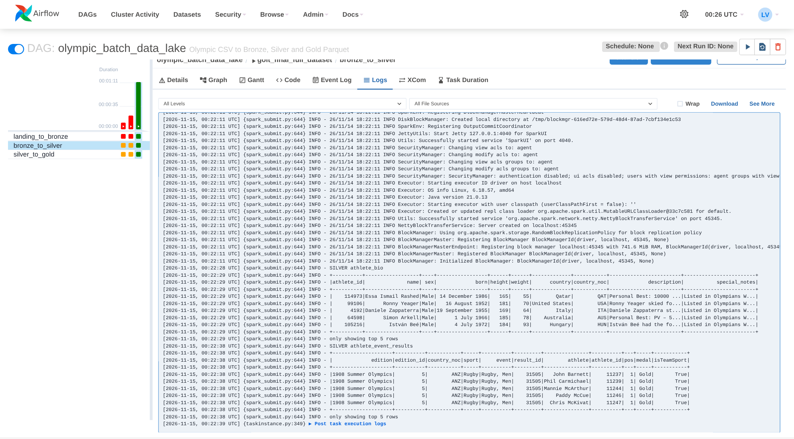
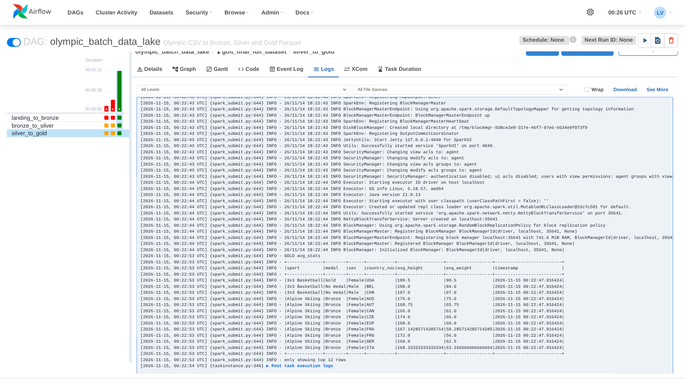
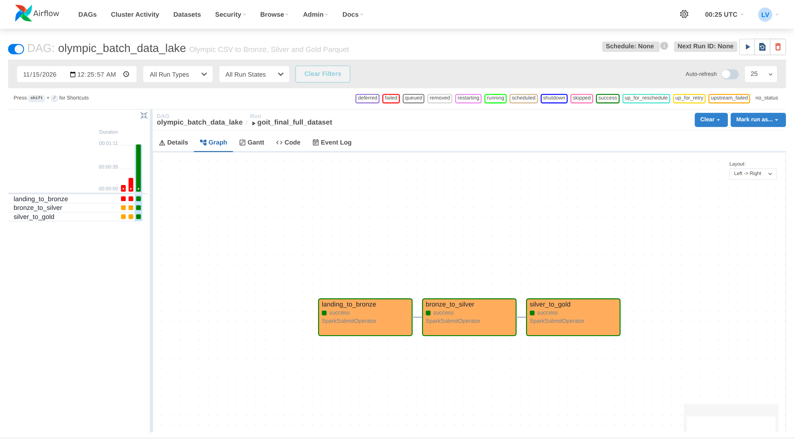

# Olympic Data Engineering Final Project

This repository implements two Olympic results pipelines. Both compute average height (cm) and weight (kg) for each combination of `sport`, `medal`, `sex` and `country_noc`.

| Part | Input | Processing | Output |
|---|---|---|---|
| 1 · Streaming | MySQL athlete bios and Kafka result events | Spark Structured Streaming with a stream–static join, incremental aggregation and `foreachBatch` fan-out | Kafka `athlete_avg_stats` and MySQL `athlete_avg_stats` |
| 2 · Batch | Both Olympic CSVs hosted by GoIT | Three Spark jobs run in sequence by Airflow | Bronze and Silver Parquet tables plus `gold/avg_stats` |

The join uses `athlete_id`. Sex and measurements come from the bio, while country comes from the event to reflect the NOC represented in that competition. Missing medals are grouped as `No medal`. Missing, nonnumeric, nonfinite and nonpositive measurements are excluded. Each usable bio contributes once per matching **event-result row** rather than once per athlete across an entire sport.

## Setup

Use Python 3.12 and Java 17 or 21. The local verification used Spark 4.0.1, Kafka 4.1.2, MySQL 8.4.5 and Airflow 2.11.2.

```bash
python -m venv .venv
source .venv/bin/activate
python -m pip install -r requirements-airflow.txt
```

For streaming alone, install `requirements.txt` instead. Jump to the [streaming screenshots](#streaming-run-screenshots) or the [batch screenshots](#batch-run-screenshots). See [EVIDENCE.md](EVIDENCE.md) for verification counts and [Project_Evidence.docx](Project_Evidence.docx) for the submission document. Neither course credentials nor database snapshots are checked into the repository.

## Part 1 — Streaming pipeline

1. Create input topic `athlete_event_results` and output topic `athlete_avg_stats` on your Kafka broker. Use an empty dedicated input topic if you plan to seed it from MySQL. Reuse the checkpoint to resume a run, not to rerun a seed.
2. Copy `.env.example` to `.env` and populate it privately. The source MySQL account needs read access to `olympic_dataset.athlete_bio` and `olympic_dataset.athlete_event_results`. The destination schema must already exist. The destination account needs CREATE (for setup), INSERT and UPDATE on the output. Use separate or shared MySQL endpoints as appropriate.
3. Run the one-off MySQL seed, then start the consumer and fan-out pipeline.

```bash
set -a
source .env
set +a

CONNECTORS='org.apache.spark:spark-sql-kafka-0-10_2.13:4.0.1,com.mysql:mysql-connector-j:8.0.32'
spark-submit --master 'local[2]' --packages "$CONNECTORS" streaming/streaming_pipeline.py seed
spark-submit --master 'local[2]' --packages "$CONNECTORS" streaming/streaming_pipeline.py stream
```

Alternatively, download [MySQL Connector/J 8.0.32](https://repo.maven.apache.org/maven2/com/mysql/mysql-connector-j/8.0.32/mysql-connector-j-8.0.32.jar) and pass it with `--jars`, supplying only Spark's Kafka connector via `--packages`. In an offline environment, supply both connectors and their runtime dependencies with `--jars`. For a finite demonstration, pass `stream --available-now`. Optionally set `MAX_OFFSETS_PER_TRIGGER` to split a backlog into several microbatches.

To reproduce without course MySQL credentials, load the original GoIT CSVs into a disposable local MySQL schema. Run the batch Landing job first to download both files, then run `python tools/load_local_mysql.py lake/landing`. This helper uses `LOCAL_MYSQL_ADMIN_USER` and `LOCAL_MYSQL_ADMIN_PASSWORD` (configure them locally). It intentionally requires new source tables.

### Review the outputs

```bash
python tools/consume_output.py --limit 5
```

The helper is intended for local, plaintext Kafka. For an authenticated broker, set `SPARK_KAFKA_OPTIONS_FILE` for the Spark pipeline and use an appropriately configured Kafka console consumer for inspection.

```sql
SELECT sport, medal, sex, country_noc, avg_height, avg_weight, timestamp
FROM athlete_avg_stats
ORDER BY sport, medal, sex, country_noc
LIMIT 10;
```

Spark keeps accumulated averages in its checkpointed state. Each successful non-empty microbatch emits changed groups with a UTC timestamp and a deterministic Kafka key. MySQL upserts by that same group key. Kafka may contain several updates for a key and may repeat one after a retry. Kafka and MySQL do not share a transaction. This example does not claim end-to-end exactly-once delivery. The athlete dimension is captured for each query invocation. Use one writer per checkpoint/output pair.

### Streaming run screenshots

The full GoIT snapshots were loaded into a local MySQL instance because course credentials were not available. For all 10,879 groups, the latest Kafka message and the MySQL row matched on both averages and the UTC calculation timestamp.

**Kafka output topic**



**MySQL output table**



## Part 2 — Batch data lake

The jobs default to the original GoIT HTTPS downloads under `https://ftp.goit.study/neoversity/`. The datasets remain outside Git. The same Spark jobs can run locally or through Airflow's `SparkSubmitOperator`.

```bash
spark-submit --master 'local[2]' batch/landing_to_bronze.py --root "$PWD/lake"
spark-submit --master 'local[2]' batch/bronze_to_silver.py --root "$PWD/lake"
spark-submit --master 'local[2]' batch/silver_to_gold.py --root "$PWD/lake"
```

- `landing/` contains the downloaded CSVs byte for byte. Bronze preserves the headers and values as strings and handles quoted multiline descriptions.
- Silver applies a Python Spark UDF to each text column and drops duplicate rows. The UDF removes control and formatting characters while preserving Unicode accents, word boundaries and meaningful punctuation.
- Gold casts measurements to doubles, joins by `athlete_id`, computes the averages and writes a UTC calculation timestamp to `gold/avg_stats`.
- Each application uses `show()` on its written Parquet output. The Airflow Log tab records those rows with task-log timestamps.

### Airflow

Run Airflow from the activated virtual environment with `spark-submit` on its PATH. In a new local Airflow installation, register the Spark connection.

```bash
export AIRFLOW_HOME="$PWD/airflow_home"
export AIRFLOW__CORE__DAGS_FOLDER="$PWD/dags"
export AIRFLOW__CORE__LOAD_EXAMPLES=False
export OLYMPIC_PROJECT_ROOT="$PWD"
export LAKE_ROOT="$PWD/lake"
airflow db migrate
airflow connections add spark-default --conn-type spark --conn-host 'local[2]'
airflow standalone
```

In the UI, unpause and trigger `olympic_batch_data_lake`. Open Graph after all three tasks are successful and then open each task's Logs to find `BRONZE`, `SILVER` or `GOLD`.

In the GoIT sandbox, use its existing `spark-default` connection. Deploy `dags/project_solution.py` plus the `batch/` package, point `OLYMPIC_PROJECT_ROOT` to the project root on the Airflow worker and set `LAKE_ROOT` to the shared POSIX mount visible at the same location to the driver and Spark executors. The driver also needs access to the course HTTPS downloads. If the executors cannot import the project package from the shared deployment, zip `batch/` (preserving the package directory) and set `OLYMPIC_SPARK_PY_FILES` to the ZIP path for `--py-files`. The sandbox's separate deployment instructions use encryption before pushing anything to the shared course repository. The public homework repository contains code and evidence, not connection secrets.

### Batch run screenshots

Airflow run `goit_final_full_dataset` completed successfully on the full GoIT CSVs. Each log below includes the UTC task-log timestamps and the Spark `show()` output.

**Landing to Bronze**



**Bronze to Silver**



**Silver to Gold**



**Successful DAG run**



## Tests

```bash
PYSPARK_SUBMIT_ARGS='--master local[2] pyspark-shell' python -m unittest discover -v
```

The tests cover invalid bio rows, deduplication by athlete before the join, null-medal grouping, numerical averages, Unicode cleaning and expansion of Kafka JSON fields.
