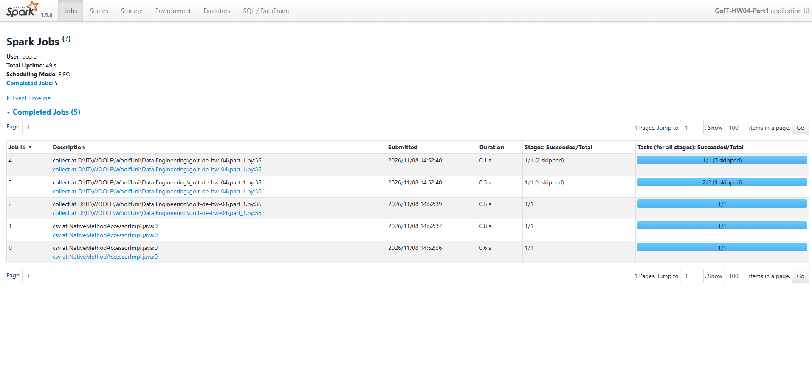
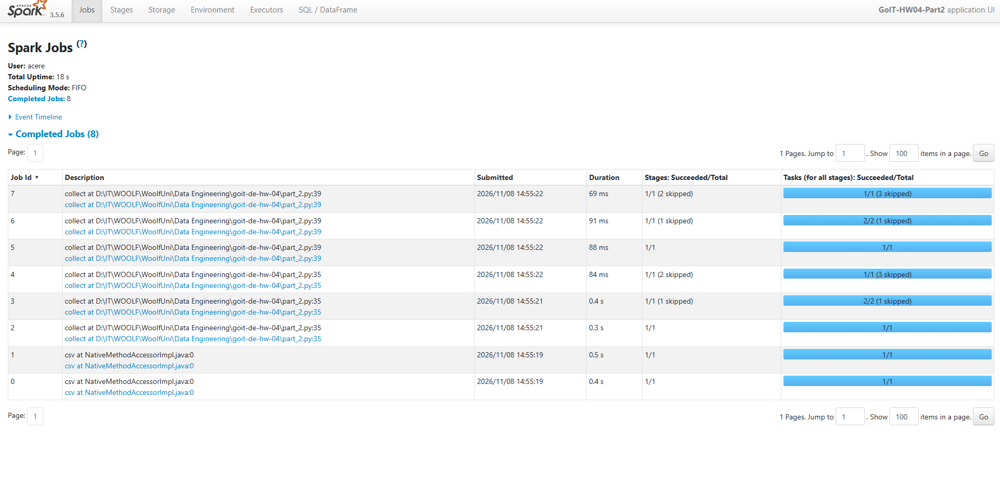
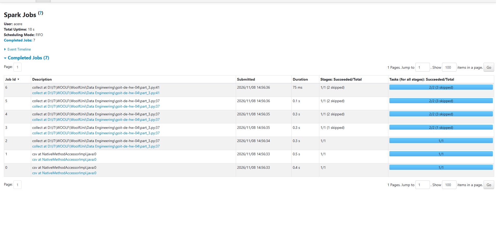

# Apache Spark HW04 — Optimization and Spark UI

## Project Overview

This project explores how Apache Spark executes transformations and actions, how execution is represented in the Spark UI, and how caching affects repeated computations.

The homework compares three PySpark programs that process the `nuek-vuh3.csv` dataset. The principal tasks are to execute each program, capture the **Jobs** tab in Spark UI, and explain the differences.

## Project Structure

```text
goit-de-hw-04/
├── part_1.py
├── part_2.py
├── part_3.py
├── nuek-vuh3.csv
├── screenshots/
│   ├── part_1_jobs.png
│   ├── part_2_jobs.png
│   └── part_3_jobs.png
└── README.md
```

## Environment Setup (Windows)

Use a compatible Python version (for example, Python 3.11) and JDK 17 for PySpark 3.5.x.

```powershell
py -3.11 -m venv .venv
.\.venv\Scripts\Activate.ps1
python -m pip install pyspark==3.5.6
java -version
```

Place `nuek-vuh3.csv` in the project root before running the scripts.

## Running the Programs

Run each program separately:

```powershell
python part_1.py
python part_2.py
python part_3.py
```

When a script pauses at the input prompt, open [Spark UI — Jobs](http://localhost:4040/jobs/) and capture the complete Jobs list **before pressing Enter**. Then close the session and run the next program.

## Part 1 — One Action

The program repartitions the input data, filters rows with `final_priority < 3`, groups by `unit_id`, counts the records, and filters the aggregated result (`count > 2`). A final `collect()` triggers execution.

**Expected Jobs in the assignment environment: 5.**



[View Part 1 screenshot](screenshots/part_1_jobs.png)

## Part 2 — Intermediate `collect()`

This variant calls `collect()` on the grouped DataFrame **before** filtering by `count > 2`, and then calls `collect()` again on the filtered result. Because the intermediate result is not cached, Spark may repeat portions of the upstream computation.

**Expected Jobs in the assignment environment: 8.**



[View Part 2 screenshot](screenshots/part_2_jobs.png)

## Part 3 — Using `cache()`

The grouped DataFrame is marked with `cache()` before the first `collect()`. That first action computes and populates the cached result. The second action can reuse cached partitions rather than repeating the full upstream work. The cache is released with `unpersist()`.

**Expected Jobs in the assignment environment: 7.**



[View Part 3 screenshot](screenshots/part_3_jobs.png)

## Results Comparison

| Part | Actions | Cache | Expected Jobs |
| --- | --- | --- | ---: |
| 1 | One final `collect()` | No | 5 |
| 2 | Intermediate and final `collect()` | No | 8 |
| 3 | Intermediate and final `collect()` | Yes | 7 |

*These Job counts are the expected results specified by the homework. Actual numbers can vary depending on the Spark version, query planner, and supporting operations such as CSV schema inference.*

## Key Findings

- **Lazy evaluation:** transformations such as `where()`, `select()`, `repartition()`, and `groupBy()` build an execution plan; an action triggers computation.
- **`collect()`:** executes a query and returns all result rows to the driver. Repeating it without caching may cause redundant upstream computation.
- **`cache()`:** marks a DataFrame for reuse. It is lazy: the cache is populated by an action, not by calling `cache()` alone.
- **Caching trade-off:** cached data consumes memory and may spill to disk. It can reduce recomputation, but does not guarantee a fixed number of Jobs or a speedup in every workload.
- **Spark UI:** the Jobs and Stages views help identify repeated work and compare execution plans.

## Conclusion

The exercise illustrates that the number of Spark actions is not necessarily equal to the number of Jobs shown in Spark UI. An additional `collect()` can trigger further work, while caching an intermediate DataFrame can reduce repeated processing. The screenshots above document the execution of each variant.