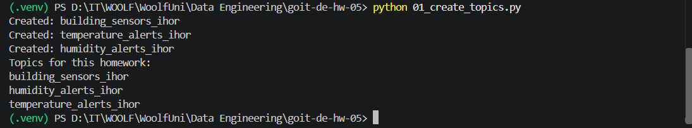
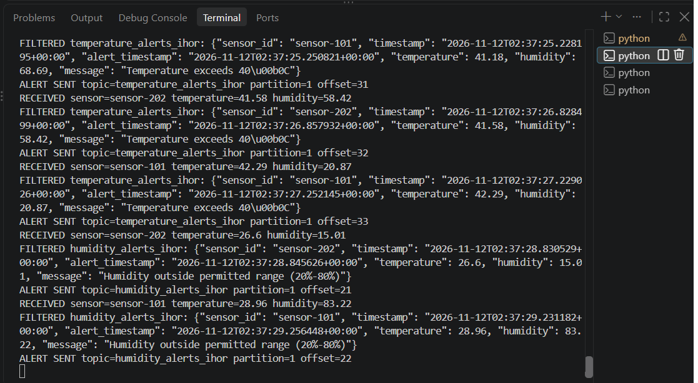
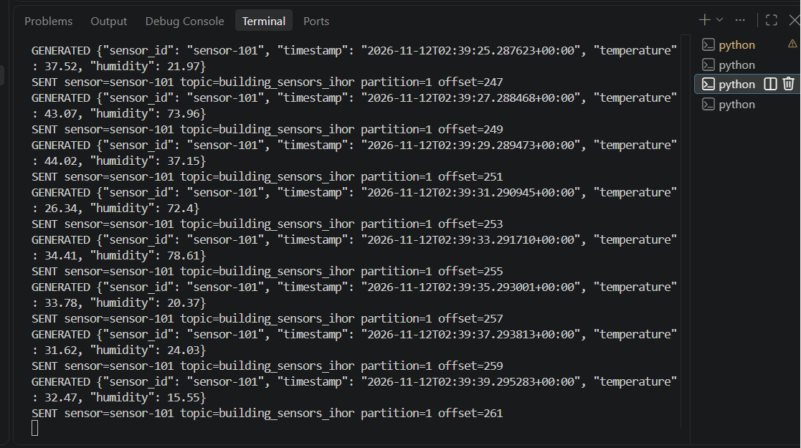
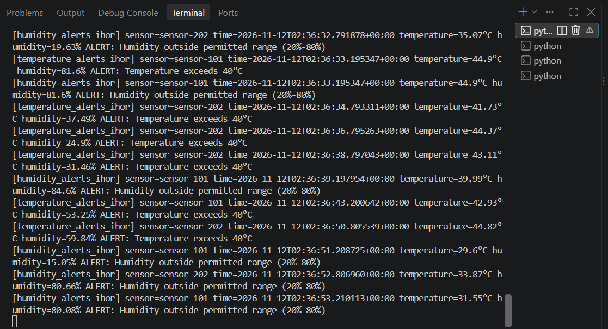
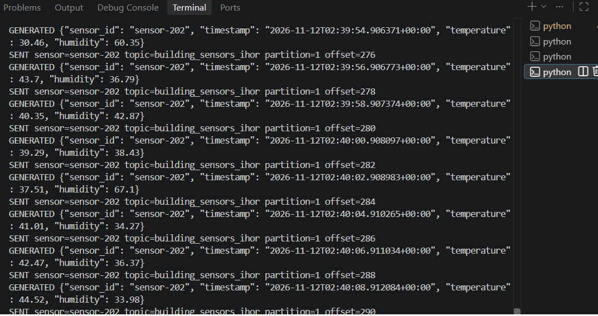

# Homework 05 — Apache Kafka

**Repository:** `goit-de-hw-05`  
**Topic:** Real-Time IoT Sensor Data Processing with Python and Apache Kafka

## Project Objective

Build a streaming system in which independent IoT sensors publish temperature and humidity measurements to Apache Kafka. A separate processor evaluates incoming measurements and publishes alerts to dedicated topics. An alert consumer then displays the alerts in the terminal.

## Architecture

```text
Sensor 101 ─┐
            ├──► building_sensors_ihor ──► Alert Processor ──┬──► temperature_alerts_ihor ──┐
Sensor 202 ─┘                                                └──► humidity_alerts_ihor ─────┤
                                                                                             ▼
                                                                                       Alert Consumer
```

The project uses three Kafka topics:

| Topic | Purpose |
| --- | --- |
| `building_sensors_ihor` | Raw measurements from all sensors |
| `temperature_alerts_ihor` | Alerts when temperature exceeds 40°C |
| `humidity_alerts_ihor` | Alerts when humidity is above 80% or below 20% |

Each sensor message contains `sensor_id`, `timestamp`, `temperature`, and `humidity`. Alert records also include `alert_timestamp` and a descriptive `message`. All messages are serialized as JSON.

## Prerequisites and Setup

- Python 3.10 or newer
- Docker and Docker Compose

Start Kafka and create a Python virtual environment:

```bash
docker compose up -d
python -m venv .venv
```

Activate the virtual environment in Windows PowerShell:

```powershell
.\.venv\Scripts\Activate.ps1
```

On Linux or macOS, run `source .venv/bin/activate` instead.

Install dependencies and create the Kafka topics:

```bash
pip install -r requirements.txt
python 01_create_topics.py
```

Kafka is exposed at `localhost:9092`. The `ihor` topic suffix can be customized with the `KAFKA_TOPIC_SUFFIX` environment variable.

## Running the Components

Open four separate terminals with the Python environment activated, and run:

```bash
# Terminal 1 — display alerts
python 04_alert_consumer.py

# Terminal 2 — process sensor messages and route alerts
python 03_alert_processor.py

# Terminal 3 — first sensor
python 02_sensor_producer.py --sensor-id sensor-101

# Terminal 4 — second sensor
python 02_sensor_producer.py --sensor-id sensor-202
```

Each instance of `02_sensor_producer.py` simulates **one sensor**. Its ID stays constant during that run. If `--sensor-id` is omitted, the script generates an ID automatically. Temperature values range from 25°C to 45°C, while humidity values range from 15% to 85%.

## Execution Report and Screenshots

The images below are cropped from the **user-provided screenshot of the actual terminal runs**, not fabricated console output. They are stored in the [`screenshots/`](screenshots/) directory. For better readability, replace them with full-resolution individual terminal screenshots if available.

### 1. Creating Three Kafka Topics

The `01_create_topics.py` script creates the required topics and lists those with the `ihor` suffix.



[View topic creation screenshot](screenshots/02.png)

### 2. Publishing Measurements from Two Independent Sensors

Two instances of `02_sensor_producer.py` run independently with IDs `sensor-101` and `sensor-202`, publishing measurements to `building_sensors_ihor`.

| Sensor 101 | Sensor 202 |
| --- | --- |
|  |  |

[View Sensor 101](screenshots/04.png) · [View Sensor 202](screenshots/05.png)

### 3. Consuming and Filtering Sensor Measurements

The `03_alert_processor.py` script consumes events from `building_sensors_ihor` and evaluates temperature and humidity thresholds. When a threshold is violated, the processor creates a JSON alert.



[View processor screenshot](screenshots/03.png)

### 4. Publishing Filtered Alerts to the Correct Topics

The same processor sends temperature alerts to `temperature_alerts_ihor` and humidity alerts to `humidity_alerts_ihor`. Its terminal output shows processing and publishing messages (`FILTERED`, `ALERT SENT`).


[View alert publishing screenshot](screenshots/03.png)

### 5. Consuming and Displaying Alerts

The `04_alert_consumer.py` script subscribes to both alert topics, consumes JSON messages, and displays them in the terminal.


[View alert consumer screenshot](screenshots/02.png)

### Overview of the Running System



## Results

The project implements topic creation, independent sensor simulation, message consumption and threshold filtering, publishing to dedicated temperature/humidity alert topics, and alert consumption. The screenshots document a local run. Before submitting, verify that the images clearly show the three topic names, `FILTERED` and `ALERT SENT` output, and messages arriving from both alert topics.

## Notes

- If Kafka is still starting after `docker compose up -d`, retry the topic creation script.
- `auto.offset.reset=earliest` only applies to new consumer groups; existing groups resume from their committed offsets.
- This educational implementation does not provide transactional exactly-once processing.
- Stop running components with `Ctrl+C`.
