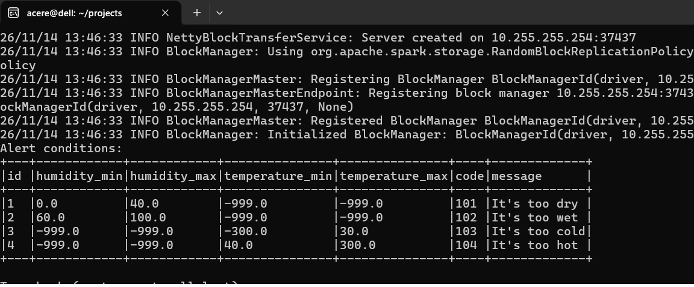

# goit-de-hw-06 — Kafka + Spark Structured Streaming

## Requirements
- Docker Desktop with Compose
- Python 3.10 or 3.11, Java 17, Apache Spark via PySpark
- The **official** `alerts_conditions.csv` downloaded from the course link

## Setup
```bash
docker compose up -d
python -m venv .venv
# Linux/macOS: source .venv/bin/activate
# Windows PowerShell: .venv\Scripts\Activate.ps1
pip install -r requirements.txt
python create_topics.py
```

Download the official CSV and save it as `alerts_conditions.csv` in the project root. `alerts_conditions.EXAMPLE.csv` is **illustrative only**, not the official rubric data. Inspect its column names; the script accepts `code/message` or `alert_code/alert_message`, and four `temperature_min/temperature_max/humidity_min/humidity_max` fields. Adjust the mapping in `stream_alerts.py` if the official file uses different names.

## Run the producers and Spark

Run each producer in its own terminal, with the virtual environment activated. Keep both running.

```bash
python producer.py --sensor-id 1 --interval 2  # Terminal 1
python producer.py --sensor-id 2 --interval 2  # Terminal 2
```

In a third terminal, activate the virtual environment and launch Spark with the Kafka connector that matches PySpark 3.5.3.
```bash
spark-submit --packages org.apache.spark:spark-sql-kafka-0-10_2.12:3.5.3 stream_alerts.py
```

Read output topic:
```bash
docker compose exec kafka /opt/kafka/bin/kafka-console-consumer.sh --bootstrap-server localhost:9092 --topic building_sensors_alerts --from-beginning
```

Check input topic:
```bash
docker compose exec kafka /opt/kafka/bin/kafka-console-consumer.sh --bootstrap-server localhost:9092 --topic building_sensors --from-beginning
```

**Important:** Watermark + append mode emits a window only after the watermark passes its end; with continuous current-time events this is typically ~70+ seconds after a window starts. Keep the producers running long enough. Output is per sensor and per sliding window, not per individual reading. Do not delete the checkpoint during a normal restart.

## Execution screenshots

### 01. Inspect the alert rules

The command `head -n 3 alerts_conditions.csv` prints the header and the first two rules from the CSV. The file provides the temperature and humidity thresholds used by Spark.


### 02. Start the producer for sensor 1

The first producer generates a reading for sensor `1` every two seconds and sends it to `building_sensors`. Each record contains `id`, `temperature`, `humidity`, and `timestamp`.


### 03. Start the producer for sensor 2

The second producer sends readings for sensor `2` to the same topic. The two producers run in separate terminals at the same time.


### 04. Inspect Kafka messages

The Kafka console consumer runs inside the `kafka` container. Its `--topic` argument identifies whether it is reading raw sensor data from `building_sensors` or alert records from `building_sensors_alerts`.


### 05. Run the Spark streaming job

Spark computes average temperature and humidity per sensor in 60-second windows that start every 30 seconds, with a 10-second watermark. It cross-joins finalized windows with the CSV rules, filters for matches, and writes alert records to `building_sensors_alerts`.



To verify end-to-end delivery, check that `building_sensors` contains readings from both sensor IDs and that `building_sensors_alerts` contains the resulting JSON alerts. The Spark console shows processing and rule matches, but the output-topic consumer confirms Kafka delivery.

## Notes
The script treats a rule as an out-of-range alert: inactive `-999` bounds are ignored; if a rule has both temperature and humidity constraints, both must be violated. Confirm the intended logical semantics against the **official CSV** before submission. `foreachBatch` + Kafka sink is at-least-once; replay can create duplicate messages, so consumers can deduplicate using sensor/window/code.
