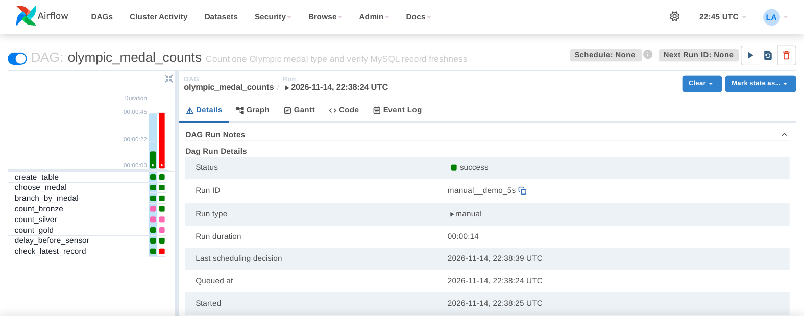
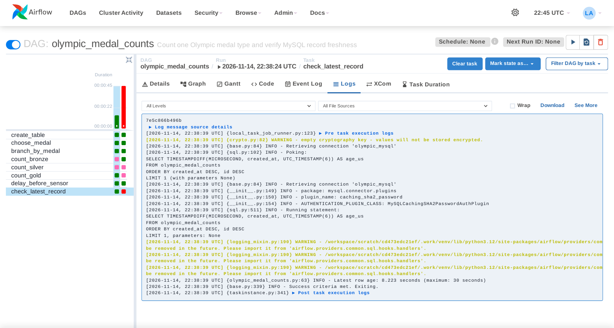
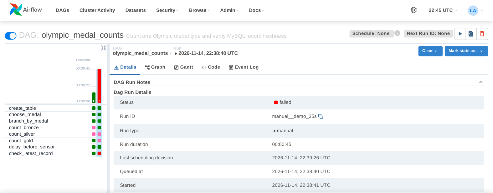
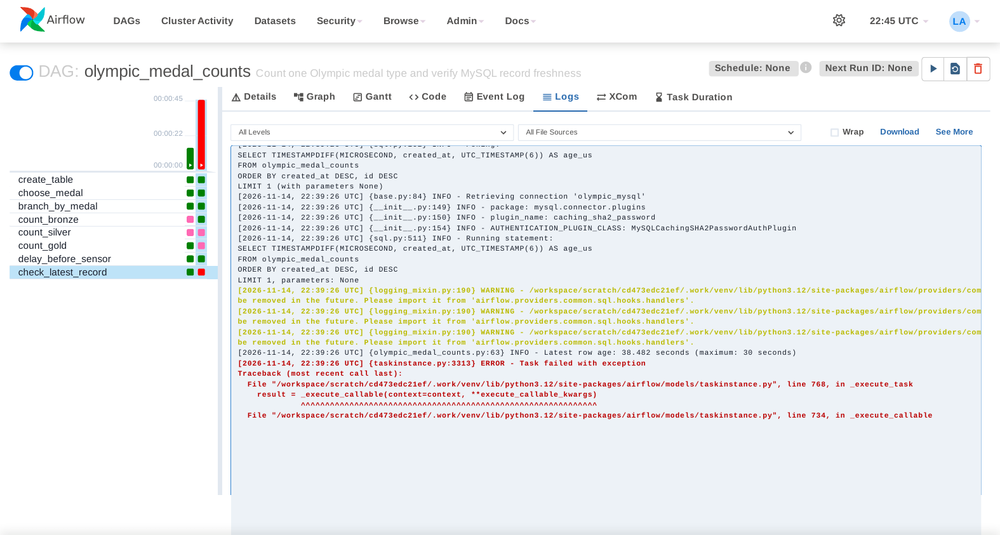
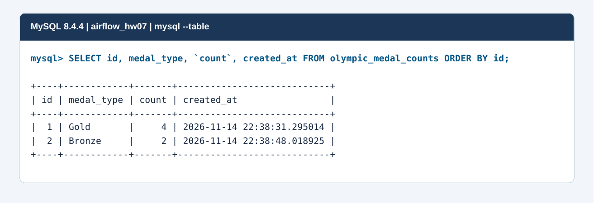

# Homework 07 · Apache Airflow and MySQL

The `olympic_medal_counts` DAG randomly selects Bronze, Silver, or Gold, counts matching rows in `olympic_dataset.athlete_event_results`, and saves the result in MySQL. After a configurable delay, a SQL sensor checks whether the newest result is at most 30 seconds old.

## How the DAG works

| Step | Airflow task | What it does |
| --- | --- | --- |
| 1 | `create_table` | Creates `olympic_medal_counts` with `CREATE TABLE IF NOT EXISTS`. The columns are `id` (auto-incrementing primary key), `medal_type`, `count`, and `created_at`. |
| 2 | `choose_medal` | Uses `random.choice()` to select Bronze, Silver, or Gold and passes the selection through XCom. |
| 3 | `branch_by_medal` | Uses `BranchPythonOperator` to run the matching count task. Airflow skips the other two branches. |
| 4 | `count_bronze`, `count_silver`, `count_gold` | Uses `INSERT … SELECT COUNT(*)` to filter by medal, count the matching rows, and save the count with a UTC timestamp in one SQL statement. |
| 5 | `delay_before_sensor` | Uses `PythonOperator` to call `time.sleep(n)`. The `none_failed_min_one_success` trigger rule lets the delay run when one branch succeeds and two are skipped. |
| 6 | `check_latest_record` | Uses `SqlSensor` to check the latest row. The sensor succeeds when the row is 0–30 seconds old, inclusive, and fails if the table is empty or the row is too old. |

The sensor finds the newest row with `ORDER BY created_at DESC, id DESC`. MySQL supplies the UTC time for both insertion and verification. Comparing timestamps in microseconds means a row aged 30.000001 seconds fails instead of being rounded down to 30 seconds. Only one DAG run can be active at a time, so another run of this DAG cannot insert a newer row during the check.

## Verified runs

Both runs used **Apache Airflow 2.10.5** and **MySQL 8.4.4** with the synthetic dataset in [`local/init-demo.sql`](local/init-demo.sql). That dataset contains 2 Bronze, 3 Silver, and 4 Gold records plus 2 rows without a valid medal. The counts below are from the local dataset, not the full GoIT dataset.

| Configured delay | Selected branch | Age measured by the sensor | Sensor status | Row stored in MySQL |
| --- | --- | ---: | --- | --- |
| 5 seconds | `count_gold` | 8.223 seconds | `success` | Gold, 4 |
| 35 seconds | `count_bronze` | 38.482 seconds | `failed` | Bronze, 2 |

The configured delay is only part of the row’s measured age. Airflow also takes time to start the delay and sensor tasks. In the 35-second run, MySQL saved the count successfully before the sensor rejected the row as too old.

### 5-second delay — sensor succeeds





### 35-second delay — sensor fails





### MySQL output



See the [PDF report](evidence/airflow-report.pdf) and [recorded run results](evidence/run-results.json) for more detail.

## Run locally

Install Docker Desktop or Docker Engine with Docker Compose v2. From the repository root, run the following commands.

```bash
docker compose up -d
docker compose logs -f airflow
```

Open the [Airflow UI](http://localhost:8080) and sign in as `admin`. Once Airflow starts, retrieve the generated password for the local instance.

```bash
docker compose exec airflow cat /opt/airflow/standalone_admin_password.txt
```

Open `olympic_medal_counts` and select **Trigger DAG**. Set `delay_seconds` to `5`, wait for the run to finish, then repeat with `35`. The 5-second run should succeed if the measured age is within the 30-second limit. The 35-second run should insert a row and then fail the sensor.

You can also trigger the runs from a terminal.

```bash
docker compose exec airflow airflow dags trigger olympic_medal_counts --conf '{"delay_seconds":5}'
# Wait for the first run to finish before starting the second.
docker compose exec airflow airflow dags trigger olympic_medal_counts --conf '{"delay_seconds":35}'
```

Query the output table to confirm both rows were saved.

```bash
docker compose exec mysql mysql -uolympic_demo -polympic_demo airflow_hw07 -e 'SELECT id, medal_type, `count`, created_at FROM olympic_medal_counts ORDER BY id DESC;'
```

Run the automated tests for the task graph, all three medal routes, the delay parameter, and the sensor’s 30-second boundary.

```bash
docker compose exec airflow python -m unittest discover -s /opt/airflow/hw-tests -v
```

The sample data loads only when Docker Compose initializes a new local MySQL volume. The example credentials are for the local demo only.

## Use the GoIT MySQL database

1. Place [`dags/olympic_medal_counts.py`](dags/olympic_medal_counts.py) in your Airflow DAGs folder. If you are installing Airflow yourself, use [`requirements.txt`](requirements.txt) and the official Airflow 2.10.5 constraints for your Python version.
2. Create a **MySQL** connection named `olympic_mysql` in Airflow. Enter the host, port, username, password, and a schema you can write to. To use MySQL Connector/Python, set the connection’s **Extra** field to `{"client":"mysql-connector-python"}`. Keep real credentials in Airflow Connections or your environment’s secret store.
3. The connection must have `SELECT` access to `olympic_dataset.athlete_event_results` and `CREATE`, `INSERT`, and `SELECT` access in your output schema on the same MySQL instance.
4. If deploying to the shared [GoIT Airflow Sandbox](https://github.com/goitacademy/airflow_sandbox), follow its README for encryption and deployment. Publishing the homework repository itself does not require write access to the GoIT repository.
